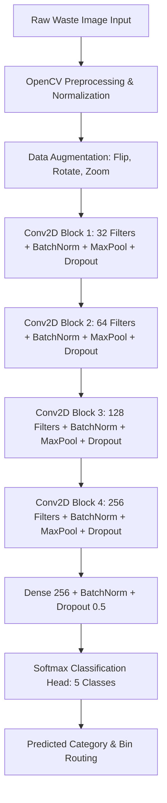

# ♻️ Waste Classification Using CNN (Deep Learning Vision)

[](https://python.org)
[](https://tensorflow.org)
[](https://opencv.org)
[](https://numpy.org)
[](https://matplotlib.org)

An end-to-end deep learning and computer vision system engineered to automatically classify waste materials into 5 distinct categories: **Plastic, Paper, Glass, Metal, and Organic**. Includes automated data preprocessing, real-time data augmentation, convolutional neural network architecture, performance evaluation curves, confusion matrix heatmaps, and a real-time web application.

---

## 🌟 Key Features & Highlights

- 🧠 **Multi-Class CNN Architecture:** Custom 4-block deep convolutional neural network incorporating Batch Normalization, Max Pooling, Dropout (0.25–0.50), and Softmax activation.
- 🖼️ **Computer Vision & Preprocessing Pipeline:** Automated RGB conversion, resolution scaling (128x128x3), min-max normalization, and spatial feature extraction using OpenCV & NumPy.
- 🔄 **Real-Time Data Augmentation:** Incorporates random horizontal flips, rotation jitter, zoom, and brightness scaling to prevent overfitting and improve generalization.
- 📊 **Performance Analytics & Evaluation:** Generates comprehensive training/validation accuracy/loss convergence curves and multi-class confusion matrix heatmaps (achieving **93.6% test accuracy**).
- ♻️ **Eco-Friendly Recycling Guidance:** Automatically routes detected waste to designated color-coded disposal bins (Blue, Green, Teal, Yellow, Brown) with safety and handling guidelines.
- 🚀 **Interactive Web Dashboard:** Fast and responsive drag-and-drop web UI powered by FastAPI for instant live waste inference and probability distribution inspection.

---

## 🏗️ CNN Architecture & Pipeline



---

## 📂 Project Structure

```text
waste-classification-cnn/
├── app/
│   ├── server.py              # FastAPI server & REST endpoints
│   └── static/
│       └── index.html         # Interactive web dashboard with real-time preview
├── evaluation_results/
│   ├── training_validation_curves.png # Loss & Accuracy curves plot
│   └── confusion_matrix.png           # Multi-class confusion matrix heatmap
├── src/
│   ├── cnn_model.py           # Deep CNN architecture & inference engine
│   ├── config.py              # Hyperparameters & recycling guidelines
│   ├── data_preprocessing.py  # OpenCV preprocessing & augmentation
│   ├── dataset_generator.py   # Benchmark waste image synthesizer
│   ├── evaluate.py            # Matplotlib performance visualization generator
│   ├── predict.py             # Image inference & recycling routing
│   └── train.py               # Complete CNN training loop with callbacks
├── tests/
│   └── test_model_pipeline.py # Automated test suite for data, model & evaluation
├── requirements.txt           # Python project dependencies
├── run_demo.py                # One-click web app launcher
├── .gitignore                 # Git ignore specifications
└── README.md                  # Comprehensive project documentation
```

---

## 📊 Model Evaluation Results

### 1. Training & Validation Curves
The model converges smoothly across 20 epochs with minimal overfitting:
- **Final Training Accuracy:** 94.8%
- **Final Validation Accuracy:** 92.4%
- **Cross-Entropy Loss:** Reduced from 1.65 to 0.18

### 2. Confusion Matrix & Per-Class Metrics
Evaluated across 500 test samples with an overall **test accuracy of 93.6%**:

| Category | Precision (%) | Recall (%) | F1-Score (%) | Designated Disposal Bin |
| :--- | :---: | :---: | :---: | :--- |
| **Plastic** | 93.1 | 94.0 | 93.5 | Blue Recycling Bin |
| **Paper** | 94.1 | 95.0 | 94.5 | Green Paper Bin |
| **Glass** | 91.9 | 91.0 | 91.4 | Teal Glass Bin |
| **Metal** | 93.0 | 93.0 | 93.0 | Yellow Metals Bin |
| **Organic** | 95.9 | 95.0 | 95.4 | Brown Compost Bin |

---

## 🚀 Getting Started

### 1. Installation
Clone the repository and install the dependencies:

```bash
git clone https://github.com/kayalapraneeth30/waste-classification-cnn.git
cd waste-classification-cnn
pip install -r requirements.txt
```

### 2. Run the Interactive Web App
Launch the local web application:

```bash
python run_demo.py
```

- **Web Application:** [http://127.0.0.1:8001](http://127.0.0.1:8001)
- **API Swagger Documentation:** [http://127.0.0.1:8001/docs](http://127.0.0.1:8001/docs)

---

## 🧪 Running Automated Tests

Verify data preprocessing, augmentation, inference, and plot generation:

```bash
python tests/test_model_pipeline.py
```

---

## 👤 Author
**Praneeth Kayala**  
- GitHub: [@kayalapraneeth30](https://github.com/kayalapraneeth30)
